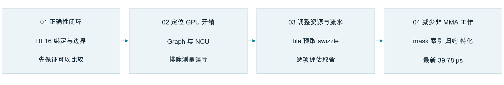
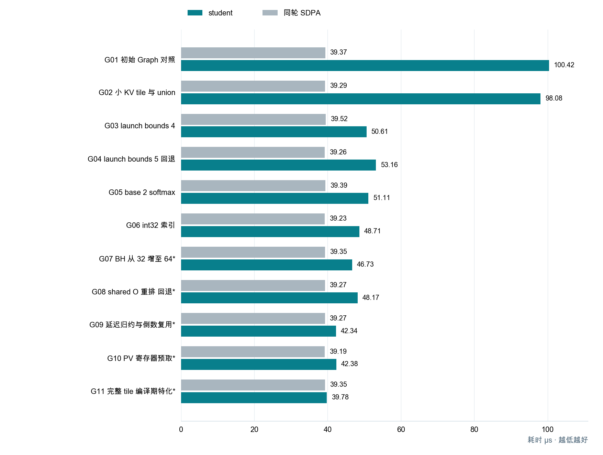
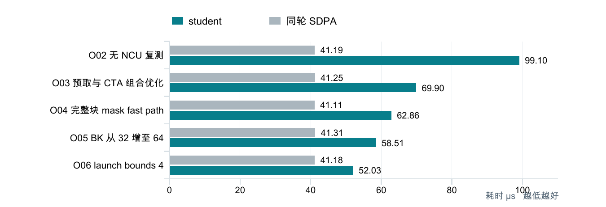
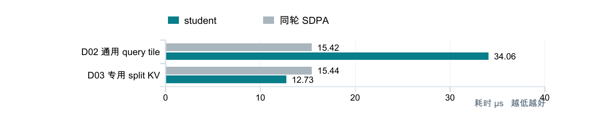
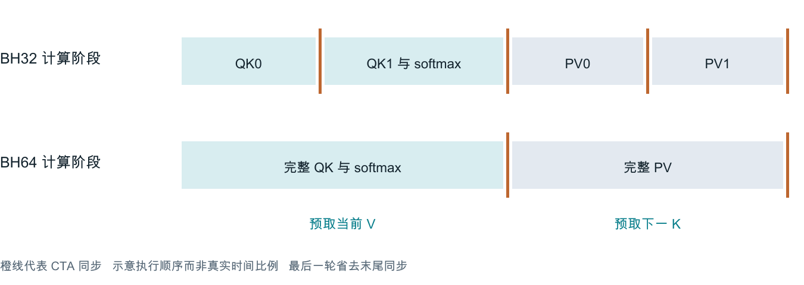

# BF16 Attention 前向优化路径报告

A100 上从可运行实现到接近 FlashAttention 的工程复盘

记录范围  2026年10月7日至8日    项目  Tiny Transformer

本轮优化围绕 BF16 causal attention 前向展开：先修复接口和边界错误，再用独立计时与 NCU 定位开销，逐步调整 tile、预取、寄存器预算、mask 和行内归约。最新记录的 prefill 耗时为 **39.78 µs**，同轮 SDPA 为 **39.35 µs**，差距收敛到 **0.43 µs**。最新阶段为完整序列 tile 的编译期特化，已提交为 `66ec6cb`。

| 最新 student prefill | 同轮 SDPA FlashAttention | 剩余耗时差 |
| --- | --- | --- |
| 39.78 µs | 39.35 µs | 0.43 µs |

同轮速度比为 SDPA / student = 0.99×；student 的延迟高约 1.1%。初始 Graph 记录为 100.42 µs，后期沿用 Graph 语境的结果下降至 39.78 µs，端点参考性降幅约 60.4%，对应约 2.52× 加速。接近 SDPA 的结论限于本次固定形状和测试条件，不代表所有序列长度、布局或功能均等价。该端点比较不等于严格配对实验，测量证据分级见后文。



图 1 优化主线 先保证可比 再以实测选择取舍

### 主要结论

- 有效收益来自组合：数据搬运与同步优化建立基础，mask 和 int32 减少标量工作，延迟归约与倒数复用降低约 9.4% 的阶段耗时，随后完整 tile 编译期特化再降低约 6.1%。

- 资源指标不是最终目标：更高 occupancy、零 spill、更高 sector 利用率，都不必然使 kernel 更快。

- 已有反例并及时回退：更紧的 launch bounds、shared-memory 输出重排均未获得净收益；base-2 和 PV 寄存器预取的单独实验没有明显收益。

测量场景：A100 80GB PCIe；BF16；B=8、H=12、D=64；prefill Tq=Tk=512；20 次预热、每轮 100 次调用、5 轮采样。

## GPU 执行路径的性能演进

下图只列 Graph 或沿用 Graph 语境的记录。灰色为同轮 SDPA，青色为 student；标注“回退”的候选未进入保留路径。图中跳过的 operator 阶段另列下一页，因此相邻条目不能全部解释为单一改动的收益。



图 2 Graph 口径的观测序列  G07 至 G11 带星号表示完整命令未附在结果片段中

| 对照 | 变化 | 结论 |
| --- | --- | --- |
| G03 → G04 驻留目标 4 → 5 | 50.61 → 53.16 µs  +5.0% | 退回目标 4 |
| G03 → G05 base-2 | 50.61 → 51.11 µs  +1.0% | 未测出明显收益 |
| G05 → G06 int32 | 51.11 → 48.71 µs  -4.7% | 保留 |
| G07 → G09 归约与倒数组合 | 46.73 → 42.34 µs  -9.4% | 保留 |
| G09 → G10 PV 寄存器预取 | 42.34 → 42.38 µs  +0.1% | 基本持平，当前代码保留 |
| G10 → G11 完整 tile 特化 | 42.38 → 39.78 µs  -6.1% | 最新已测版本 |

证据边界：G07 至 G11 沿用此前 Graph 测试上下文，但保留的日志片段只有结果行，没有完整 CLI。本文保留这些结果并明确标记；不据此宣称所有中间改动都被严格隔离，亦不提供缺失的置信区间。

## 完整算子口径与 decode 改善

operator 计时包含完整 eager 调用，可能包含 CPU 提交造成的 GPU 间隙；它适合回答“调用一次算子需要多久”。下图记录均来自未挂 NCU 的 operator 日志。



图 3 Operator 路径  预取与 CTA 改动的收益不能拆成独立百分比

| 阶段对照 | student 延迟下降 | 说明 |
| --- | --- | --- |
| O02 → O03 | 29.5% | 预取 CTA 与 fragment 相关组合 |
| O03 → O04 | 10.1% | mask fast path 阶段  版本归因有保留 |
| O04 → O05 | 6.9% | BK 从 32 增至 64 |
| O05 → O06 | 11.1% | launch bounds 的驻留目标设为 4 |

### 单 token decode 采用独立执行路径



图 4 Decode 的 Graph 对照  Tq=1 Tk=512

通用 kernel 为 1 个 query 仍执行 64 行 tile。专用路径按 128 个 key 分块并用 FP32 合并 softmax，Graph 从 34.06 降至 12.73 µs，快 2.68 倍，同轮达到 SDPA 的 1.21× 速度。适用范围为 Tq=1、Tk≤4096，不计入 prefill 收益。

## Tile 与流水线如何演化

最终保留的主线遵循 Q 整块保留在 shared memory、P 和 O 在寄存器的设计。K/V 从特征 subtile 发展到完整 head-dimension tile，以更多共享内存换取较少的阶段切换。

| 配置阶段 | Q 与 KV 存储 | 共享内存每 CTA | 状态 |
| --- | --- | --- | --- |
| 初始模板 | Q 8 KiB  P 8 KiB<br>K 与 V 各两份完整 tile | 48 KiB | 正确性起点 |
| Q 常驻寄存器候选 | Q 借用 V 缓冲后进入寄存器<br>P 改为寄存器转换 | 32 KiB | 未单独验证收益 后续放弃 |
| BK32 BH32 | Q 8 KiB<br>两个 K/V union stage 各 2 KiB | 12 KiB | 资源压缩探索 |
| BK64 BH32 | Q 8 KiB<br>两个 union stage 各 4 KiB | 16 KiB | 减少 KV 迭代 |
| BK64 BH64 | Q 8 KiB  K 8 KiB  V 8 KiB<br>K/V 两个完整 slot | 24 KiB | 最终已测布局 |



图 5 以更大的特征 tile 减少同步切换

BK=32→64 时，T=512 每个 head 的 KV tile 处理总数从 72 降到 36。BH=32→64 时，去掉 DH 方向的两段循环；每个 CTA 处理 N 个 KV 块的同步总数从 4N 降到 2N，含 prologue 和最后一轮收尾。S/P/O 的大小在 BH 变化时不变，但 PV 临时 B fragment 会增大。

K/V 行宽改变时必须同步修改 swizzle。32-BF16 行最终使用 Swizzle<2,3,3>，64-BF16 行使用 Swizzle<3,3,3>。错误的 Swizzle<2,3,2> 保持了数值布局可逆性，却让相隔四行的片段发生 bank 冲突。

### 早期同步合并、CTA 次序与寄存器预算

小 subtile 阶段先将 Q 和首个 K 放进同一异步拷贝组，并把 K/V 阶段切换与下一 tile 的等待合并。处理 N 个 KV tile 的 CTA，barrier 从 `1+6N` 降到 `4N`；随后 BH64 才进一步降到 `2N`。这两次改动处于不同阶段，不能把减少的 barrier 次数直接当成耗时降幅。

CTA 编号按 query tile 降序、同一 tile 内遍历 batch/head，让因果前缀较长的任务在编号上靠前，以尝试缓解尾效应。CUDA 不保证严格按 block 编号执行，因此它只是调度提示，不能保证消除末波空闲。该改动与早期预取/B fragment 实验组合，缺少独立计时。

QK 的 Q 仅按 K=16 加载寄存器片段，整块 Q 继续常驻 shared memory；P 则利用 MMA 的 C→A 线程内坐标对应直接转换为 BF16 fragment，无需 shared P 或跨线程搬运。缩小 rS 的源码作用域可以表达其在 PV 前结束使用，但最终活跃寄存器由编译器决定。BH64 下每线程 S、P、O 分别为 32 个 FP32、32 个 BF16、32 个 FP32，统计量和临时 fragment 另计。

157-register 版本虽无 spill，但在 A100 上资源驻留受限；`launch_bounds(128,4)` 给出更紧的编译预算后，operator 从 58.51 降到 52.03 µs。继续要求 5 CTA/SM 却让 Graph 从 50.61 退化到 53.16 µs。最终保留目标 4，依据是实际延迟，不是单独追求更高 occupancy 或零 spill。

### Global→shared 预取与 shared→register 预取是两个层次

第一层使用 `cp.async`：V 的 global→shared 加载与当前 QK/softmax 重叠，下一 K 的加载与当前 PV 重叠。第二层才是 `ldmatrix` 提前把下一 V fragment 从 shared memory 搬入寄存器，再执行当前 fragment 的 MMA。第一层的 slot 复用需要 CTA 同步；第二层增加寄存器存活值，本次未增加 CTA barrier。

PV 实验只修改 `gemm_pv_subtile`，保留 `rB0/rB1` 两个显式寄存器 fragment，使用编译期 `make_seq` 和 `if constexpr` 交替，避免动态索引数组。每个 fragment 覆盖 K=16，单线程保存 32 个 BF16 值：

```text
load V0 → rB0
load V1 → rB1; MMA(P0, rB0)
load V2 → rB0; MMA(P1, rB1)
load V3 → rB1; MMA(P2, rB0)
               MMA(P3, rB1)
```

最后一次不再预取，复用寄存器前对应 MMA 已消费旧值。QK、KV tile、softmax 与输出路径均保持原样。历史实测 **42.34→42.38 µs**，同轮 SDPA 39.19 µs；ptxas 为 **120 registers、0 stack、0 spill**。这属于没有测出收益的实验，不能因为零 spill 或源码上“先 load 再 MMA”就声称隐藏了延迟；实际重叠还受编译调度与依赖限制。此版本提交 `8574747`，当前代码仍保留它作为完整 tile 特化的直接基线。

## 减少非 MMA 指令的关键收益

### 完整合法块跳过逐元素 mask

在 query tile 和 key tile 都完整、且最早 query 已能看到该 key 块最后位置时，整个 tile 无需 causal 判断。其余块保留逐元素检查。BK=64、T=512 时，每个 head 的 36 个 KV tile 中有 28 个完整合法块。该阶段 operator 从 69.90 降到 62.86 µs，约改善 10.1%，但与 N=8 展开回撤的版本对应尚未完全固化。

### 用 int32 表达索引 保留 int64 地址偏移

tile 计数、行列坐标与 mask 比较改用 int32；host 在连续化与分配前检查 Tk≤INT32_MAX。row×DH 和 batch/head 偏移在乘法前提升为 int64。因果比较写成 kj-past_len≤qi，尾块先限长再相加，避免 padded 索引溢出。Graph 从 51.11 降到 48.71 µs，约改善 4.7%。

### Base-2 softmax 与缩放位置调整

保留未缩放的 QK 分数，先归约最大值、再对每行最大值乘 `scale2=(1/sqrt(DH))*log2(e)`，概率使用 `exp2f(fmaf(score,scale2,-m2_new))`。历史状态的重缩放系数为 `exp2f(m2_old-m2_new)`；初始最大值及全 mask 行有专门保护，避免 `-inf-(-inf)`。最终 LSE 用 `m2*ln(2)+ln(denominator)` 还原自然对数，不能直接返回 log2 LSE。

这个组合避免单独逐元素缩放全部 score，但实测 Graph 50.61→51.11 µs，没有明显收益。实现保留为后续固定基线，未开启全局 fast-math，也未把该步骤算作独立提速。中途 `__exp2f` 的 device 编译错误改用 `exp2f` 修复；后来提出的自然指数重试没有 GPU 结果，已撤回。

### 分母累计留在线程局部 最后再归约

当前每行由四个 lane 合作。每轮仍计算本 lane 的指数和，并以共同的 alpha 重缩放历史累计值；循环中无需完整行分母，所以可以把跨 lane 求和推迟到末尾。行最大值仍须每轮跨 lane 归约。

| 同一逻辑行 | lane 0 | lane 1 | lane 2 | lane 3 |
| --- | --- | --- | --- | --- |
| tile 0 后的累计部分和 | 2 | 3 | 4 | 1 |
| tile 1 新增部分和 | 1 | 2 | 1 | 4 |
| alpha=0.5 后的累计值 | 2 | 3.5 | 3 | 4.5 |

```text
for each KV tile:
    l_partial = alpha * l_partial + local_sum

denominator = row_sum(l_partial)  # after all KV tiles
inv_l = 1.0f / denominator
O = O_acc * inv_l
```

最终 shuffle 必须由尾块中所有 lane 参与，放在 qi<Tq 判断之前。倒数按每线程负责的每行计算一次，而非更新或保存以前的 S tile。对于遍历 N 个 KV 块的 CTA，分母相关 shuffle 从每线程 4N 次降为 4 次；源码中的输出除法从最多 32 次降为 2 次。

两项一起测量得到 46.73→42.34 µs，下降 9.4%。没有新增 shared-memory 访问或 CTA barrier；单项收益尚未拆分。浮点求和顺序和除法改写会改变舍入，需要继续使用 FP64 O/LSE 对照。

### 完整序列 tile 编译期特化

此前的 mask fast path 只让完全合法的 S tile 跳过逐元素 mask；Q/K/V 加载仍对每个向量检查行边界，输出仍检查 query 是否越界。参考 FlashAttention 的 `Is_even_MN` 分派，本轮把“序列没有尾块”变成模板参数，让编译器移除这些通用路径指令。

```cpp
// attention.cu：连续化、16-byte 对齐和尺寸检查仍在 host 完成。
if (Tq % BQ == 0 && Tk % BK == 0)
    launch_forward(std::true_type{});   // forward<true>
else
    launch_forward(std::false_type{});  // forward<false>
```

| 位置 | 原通用路径 / `forward<false>` | 完整 tile / `forward<true>` |
| --- | --- | --- |
| Q/K/V 向量加载 | 检查 `row0+r<rows`，选择安全源地址并 zero-fill | 无行边界谓词的 `SM80_CP_ASYNC_CACHEGLOBAL` |
| Query tile 终点 | `q0 + min(tq-q0, BQ)` | `q0+BQ` |
| fully_valid | query/key 完整且最早 query 可见最后 key | 只判断 `past_len+q0-key0 >= BK-1` |
| 边界 S tile | query/key 越界检查加 causal mask | 只保留 `kj-past_len<=qi` |
| O/LSE 写回 | `qi<tq` 才写入 | 编译期移除行边界判断 |

这不是去掉 causal mask：512×512 prefill 的对角 tile 仍必须逐元素屏蔽未来 key。两种长度都整除才启用特化；query 或 key 单独整除仍走通用路径。16-byte 指针对齐由 host 另行保证，不能用“序列整除”替代地址对齐检查。

本轮保持 BQ=BK=BH=64、128 线程、24 KiB shared memory、`launch_bounds(128,4)`、PV 预取、base-2 softmax、分母延迟归约与直接 O pair stores，未同时做首轮 softmax 特化。当前 benchmark 的 Tq=Tk=512 自动命中 `forward<true>`。

历史实测 **student 39.78 µs、SDPA 39.35 µs**，较直接基线 42.38 µs 降低 2.60 µs，约 **6.1%**。这是整个特化改动的观测收益；没有指令级配对计数，不能把 2.60 µs 全归因于某一种谓词，也不能推断寄存器或 occupancy 一定改善。最新特化的 ptxas 数字尚未提供。

新增 GPU 用例比较完整 tile 与追加一行 Q/K/V 后的尾块路径，保持 `past_len` 相同并检查原 query 输出不受新增未来 key 影响，分别对照 FP64 O/LSE 和 SDPA。NaN cache 尾部覆盖 full/full、tail/full、full/tail。实现时本地测试为 1 项 host 通过、24 项 CUDA 跳过；CPU 索引检查覆盖 116 组长度、982 对抽样 tile，含 int32 上限。最新 benchmark 结果证明目标环境已能运行该版本，但不替代完整 GPU 回归与 sanitizer 记录。

## 无收益实验与正确性修复

优化记录保留失败结果，避免在后续迭代中重复追求已经被实测否定的资源指标。下表中的“未隔离”表示不能依据现有日志给出单项速度贡献。

| 实验 | 观测 | 处理 |
| --- | --- | --- |
| 完整 Q 常驻寄存器 | 减少 shared memory 但增大寄存器工作集<br>没有可归因的独立提速记录 | 回到 Q shared memory |
| 手写 N=8 的 B fragment 展开 | 组合版本 128 registers<br>20 B spill stores 28 B spill loads | 展开回撤<br>预取和 CTA 排列保留 |
| launch bounds 从 4 提到 5 | Graph 50.61→53.16 µs<br>慢约 5.0% | 采用目标 4 |
| base-2 softmax | Graph 50.61→51.11 µs<br>约 1% 差异 未显示明显收益 | 保留为后续受控基线<br>不计为独立提速 |
| PV 的 V fragment 寄存器双缓冲 | 42.34→42.38 µs，120 registers、零 spill | 未测出收益；当前代码保留 |
| Q shared memory 重排输出 | 46.73→48.17 µs<br>慢约 3.1% | 撤回 直接 32-bit pair 写回 |
| int32 下重试自然指数 | 曾准备候选 随后转向 KV tile 优化<br>没有 GPU 性能结果 | 未测量 已撤回 |
| 更高 occupancy 或零 spill | 更多驻留 warp 不保证更低延迟<br>有少量 spill 的组合版本仍可能更快 | 按正确性与时间决定 |

### 性能实验之前先修复的功能问题

- 绑定与参数：修复 dtype 恒假条件、BF16 类型与指针调用、错误变量名、模板实参；LSE 使用 FP32，启动分配正确的动态共享内存。

- 输入契约：拒绝混合 dtype 和 BF16 segment IDs，检查 SM80 与 grid 上限；连续 view 的 storage_offset 仍可能不对齐，必要时 clone 保证 16-byte 对齐。

- 测试对照：未对齐原始 view 仍交给 student；SDPA 参考使用值相同的对齐副本。一次 CUDA misaligned-address 错误可能污染后续用例，需新进程重跑。

- 编译兼容：坐标 tensor 的 ScaledBasis stride 不能直接用于 fragment 排序，改为取 shape 后分配；误用 __exp2f 改为 CUDA 支持的 exp2f。

## Profiler 证据如何改变判断

| 证据 | 观测 | 工程判断 |
| --- | --- | --- |
| Shared-load bank conflict | 曾占 shared wavefronts 43.60%<br>修正 swizzle 后复查确认排除 | 地址模式确有问题<br>但不是全部耗时来源 |
| Global store sector 有效字节 | 约 8.19→16.2 / 32 bytes | 32-bit pair 写回改善合并<br>更大重排仍可能得不偿失 |
| Warp 等待 | Short Scoreboard 约 0.83→0.32<br>Long Scoreboard 在后续版本约 1.23→0.74 | 分别与 shared 冲突缓解<br>和加载重叠方向一致 |
| Occupancy | 理论 25%<br>一次实测 23.73%  15.19 active warps/SM | 接近该版资源上限<br>不等于始终有可发射 warp |
| Tail effect | 768 CTA  108 SM  4 CTA/SM<br>432+336 两波 | 50% 提示不是 50% 可消除耗时<br>causal CTA 时长也不均匀 |

### 编译资源必须按 kernel 和版本匹配

| BF16 forward 阶段 | Registers | Stack B | Spill store/load B |
| --- | --- | --- | --- |
| 修正 swizzle 后的一版 | 约 120 至 121 | 0 | 0 / 0 |
| N=8 展开等组合 | 128 | 16 | 20 / 28 |
| BK64 BH32 | 157 | 0 | 0 / 0 |
| launch bounds 4 | 128 | 0 | 0 / 0 |
| int32 base-2 | 128 | 8 | 4 / 4 |
| BH64 完整 K/V | 121 | 0 | 0 / 0 |
| 延迟归约与倒数版本 | 未提供 | 未提供 | 未提供 |
| PV 寄存器预取 | 120 | 0 | 0 / 0 |
| 完整 tile 编译期特化（最新） | 未提供 | 未提供 | 未提供 |

早期日志中的 96 registers 属于 FP32 attention_detail::forward，不是 BF16 kernel。used 1 barriers 表示 barrier 资源，不是动态执行一次同步。24 KiB 属于动态共享内存，未必出现在 ptxas 的静态 smem 字段中。

当前 128-thread CTA 在 A100 上约 121/128 registers 时，寄存器分配限制为 4 CTA/SM；157 registers 时约为 3 CTA/SM。NCU 的估计加速百分比不能相加，stall 图的周期/指令也不能直接当作总耗时占比。

### 后期 NCU 分析：不必只围绕 exp2f 热点优化

PV 实验后的报告未再显示 spill 或 shared bank-conflict 警告。内存吞吐约 346.6 GB/s，Memory Busy 40.31%、Max Bandwidth 31.51%、Mem Pipes 20.59%、L2 命中率 63.25%。这些指标不足以认定 kernel 已受 HBM 带宽限制或 Tensor Core 已饱和。

该次 warp 统计约为 Wait 1.39、Not Selected 1.03、Math Pipe Throttle 0.85、Long Scoreboard 0.61、Short Scoreboard 0.32、Barrier 0.21 cycles/issued instruction。它们属于这一版、这一轮 profiler 结果，不应拼接成各阶段严格可比的时间占比。

- `stall_wait` 表示采样 warp 正在等待固定延迟的执行依赖；`stall_wait_not_issued` 还要求该 scheduler 在这个周期没有发射指令。它不表示整个 SM 或 GPU 都没有工作。
- Source 页面默认百分比是该行在所选 metric 总量中的份额，不是 kernel 时间百分比。All 与 Not Issued 的分母不同，8.21% 与 10.47% 并不矛盾；局部/全局显示范围也会改变分母，不同 replay pass 的采样计数未必严格对应。
- 一行 `exp2f(fmaf(...))` 会关联多条展开后的 FFMA/FMUL/MUFU.EX2 指令。采样 PC 常在等待依赖的消费者处；不能仅看相同 opcode 就判断延迟来源相同。截图中的谓词与部分操作数不完整，不能断言所有指数保护分支每次都执行。
- O store 约 16.2 个有效字节/32-byte sector，报告的 196608 个 excess theoretical sectors 与半 sector 写入模式一致。这是请求层面的理论冗余，不等于额外 HBM 流量或可直接消除的时间。shared O 重排的退化结果优先于“更合并应更快”的推测。

因此没有继续强改指数路径，而是参考成熟实现移除不必要的通用边界处理。随后完整 tile 特化获得 6.1% 的观测改善，说明无需先“解决最高 stall 百分比”才能继续提速。

## 完整测量记录与口径标记

所有数值均取自保存的终端结果，单位 µs。G 为 Graph，G* 为沿用 Graph 语境但缺少完整命令的结果片段，O 为 operator，X 为挂 NCU 的诊断运行。X 项仅解释测量干扰，不纳入加速结论。

| ID | 方式 场景 | 阶段 | student | SDPA | 速度比 |
| --- | --- | --- | --- | --- | --- |
| O01 | O/P | 最初可运行 BF16 | 101.92 | 40.92 | 0.40× |
| D01 | O/D | 通用 query tile | 35.44 | 30.15 | 0.85× |
| G01 | G/P | 初始 Graph 对照 | 100.42 | 39.37 | 0.39× |
| D02 | G/D | 通用 query tile | 34.06 | 15.42 | 0.45× |
| G02 | G/P | 小 KV tile 与 union | 98.08 | 39.29 | 0.40× |
| D03 | G/D | 专用 split KV | 12.73 | 15.44 | 1.21× |
| X01 | X/P | 仅一次预热和采样 | 209.92 | 258.05 | 1.23× |
| X02 | X/P | 恢复 20 100 5 采样 | 102.79 | 158.28 | 1.54× |
| O02 | O/P | 无 NCU 复测 | 99.10 | 41.19 | 0.42× |
| O03 | O/P | 预取与 CTA 组合优化 | 69.90 | 41.25 | 0.59× |
| O04 | O/P | 完整块 mask fast path | 62.86 | 41.11 | 0.65× |
| O05 | O/P | BK 从 32 增至 64 | 58.51 | 41.31 | 0.71× |
| O06 | O/P | launch bounds 4 | 52.03 | 41.18 | 0.79× |
| G03 | G/P | launch bounds 4 | 50.61 | 39.52 | 0.78× |
| G04 | G/P | launch bounds 5 回退 | 53.16 | 39.26 | 0.74× |
| G05 | G/P | base 2 softmax | 51.11 | 39.39 | 0.77× |
| G06 | G/P | int32 索引 | 48.71 | 39.23 | 0.81× |
| G07 | G*/P | BH 从 32 增至 64 | 46.73 | 39.35 | 0.84× |
| G08 | G*/P | shared O 重排 回退 | 48.17 | 39.27 | 0.82× |
| G09 | G*/P | 延迟归约与倒数复用 | 42.34 | 39.27 | 0.93× |
| G10 | G*/P | PV 寄存器预取 | 42.38 | 39.19 | 0.92× |
| G11 | G*/P | 完整 tile 编译期特化 | 39.78 | 39.35 | 0.99× |

P=prefill，D=decode。速度比始终为 SDPA/student，大于 1 表示 student 更快。多个结果写入同一 JSON 路径，原始 trial 数组未完整保留在对话中，因此本报告不提供误差条或显著性检验。

## 复现方式与后续实验

测量环境为 A100 80GB PCIe、PyTorch 2.8.0a0+34c6371d24.nv25.08。历史 profiler 已确认 prefill 与 decode 都经过 aten::_scaled_dot_product_flash_attention。其具体 tile 配置不能仅由这个 ATen 名称推断。

### 固定输入与计时方式

```text
TORCH_CUDA_ARCH_LIST=8.0 python3 -m tiny_transformer.benchmarks \
  --operator attention --backend student --baseline sdpa \
  --precision bf16 --device cuda:1 --phases forward \
  --workloads prefill --attention-timing graph \
  --layouts contiguous --batch-size 8 --heads 12 \
  --dim 768 --seq-length 512 --warmup 20 --repeats 100 --trials 5 \
  --output runs/attention-even-tiles-graph.json
```

operator 与 Graph 分别报告；不在挂 NCU 的 benchmark 输出中判断谁更快。NCU 内核 Duration 和硬件计数器用于定位问题，无 NCU 的独立运行用于速度结论。缺少 TORCH_CUDA_ARCH_LIST 可能改变 JIT 编译架构并触发重新编译，编译等待不计入稳态计时。

`--attention-timing graph` 捕获多次完整算子调用后重放，减少 Python/host 逐次提交造成的 GPU 空隙，捕获与 host 分配不在计时内；算子中的设备拷贝、多 kernel 和设备调度仍保留。它不是只测单个 attention kernel 的 NCU Duration。命令长时间无输出还可能在 JIT 构建或初始化，不能据此推断 kernel 本身变慢，或认为加上 NCU 会加速计算。

### 正确性与编译资源

```text
TORCH_CUDA_ARCH_LIST=8.0 TINY_TRANSFORMER_CUDA_VERBOSE=1 \
python3 -m unittest discover -s tests \
  -p test_student_attention.py -k bf16 -v
```

再运行 compute-sanitizer 的 memcheck、racecheck、synccheck。已有测试覆盖 FP64 O/LSE、因果隔离、query/key 尾块、非连续和未对齐 view、非默认 stream、Graph 重放与溢出拒绝。报告主机无 CUDA；本地模型与跳过的 GPU 测试不能替代目标设备验收。

### NCU 源码关联与全指标采集

attention 扩展使用 `-O3 -std=c++17 --expt-relaxed-constexpr -lineinfo`；`-lineinfo` 提供优化代码的行号映射，不使用会改变优化行为的 `-G`。`TINY_TRANSFORMER_CUDA_VERBOSE=1` 额外输出 ptxas 寄存器和 spill 信息。需确认实际重编译的参数，不能只修改文件后沿用旧二进制。

```bash
TORCH_CUDA_ARCH_LIST=8.0 TINY_TRANSFORMER_CUDA_VERBOSE=1 ncu \
  --section 'regex:.*' --metrics 'regex:.*' \
  --import-sass yes --import-source yes \
  --source-folders /workspace/tiny-transformer/csrc/attention,/workspace/tiny-transformer/third_party/cutlass/include \
  --kernel-name-base demangled \
  --kernel-name 'regex:attention_bf16::forward' \
  --launch-skip 21 --launch-count 1 -f \
  -o runs/attention-prefill-even-tiles-allmetrics \
  python3 -u -m tiny_transformer.benchmarks \
  --operator attention --backend student --baseline sdpa \
  --precision bf16 --device cuda:1 --phases forward --workloads prefill \
  --attention-timing operator --layouts contiguous \
  --batch-size 8 --heads 12 --dim 768 --seq-length 512 \
  --warmup 20 --repeats 100 --trials 5 \
  --output runs/attention-even-tiles-profile-diagnostic.json
```

此命令请求当前设备/NCU 版本支持的全部可匹配 metrics 与 sections，可能需要大量 replay passes；不支持的指标以 NCU 实际输出为准。`launch-skip 21` 对应当前 benchmark 的一次正确性调用和 20 次匹配 kernel 的预热。原正则仍匹配两个模板实例；512×512 应显示 `forward<true>`。若 benchmark 调用顺序变化，应重新核对 skip。

源码需在采集机器的编译路径中可读；`--import-source yes` 将可关联源码导入报告，便于在另一台机器打开。优化/内联可能让一个 `.cuh` 行对应多条 SASS，也可能没有独立指令，不保证逐行一一对应。此运行打印的 student/SDPA 比值仍不能作为独立性能比较。

### 保留版本和待验证工作

最新已测主线为 `66ec6cb` 的完整 tile 特化。以下提交用于恢复和对照；耗时来自历史终端日志，不表示每个提交都在报告主机重新执行过：

| 提交 | 主要变化 | 对话中的对应结果 |
| --- | --- | --- |
| `072f1e5` | 修正 swizzle | bank conflict 排除，缺少隔离耗时 |
| `2c34374` | 合并同步、预取、CTA 次序与 B fragment 实验 | 组合阶段；不单独归因 |
| `c9048d5` | 完整合法 S tile 的 mask fast path | operator 62.86 µs，含前述版本归因保留 |
| `ca7e9eb` | BK32→64 | operator 58.51 µs |
| `fed0e34` | launch bounds 最小驻留目标 4 CTA/SM | operator 52.03 / Graph 50.61 µs |
| `a52f0a2` | 最小驻留目标 5 CTA/SM | Graph 53.16 µs，后续退回 4 |
| `e268510` | base-2 softmax，恢复目标 4 | Graph 51.11 µs |
| `b1482b4` | int32 索引 | Graph 48.71 µs |
| `e13905e` | BH32→64，完整 K/V slot | G* 46.73 µs |
| `f14345a` | Q shared memory 重排 O | G* 48.17 µs，已撤回 |
| `8732172` | 延迟分母归约、每行倒数复用，直接写 O | G* 42.34 µs |
| `8574747` | PV 的 V 寄存器预取 | G* 42.38 µs |
| `66ec6cb` | 完整序列 tile 编译期特化 | G* 39.78 µs |

提交名中出现的“4/5 warps on scheduler”不能作为 `__launch_bounds__` 第二参数的定义；该参数是编译期最小 CTA/SM 驻留目标，用来约束资源预算，不保证实际达到该驻留数。

48.71 µs 基线另有 `runs/attention-tuning/baseline-int32-base2-b1482b4/` 快照及 SHA256 manifest；`runs/` 被 gitignore 排除，跨机器恢复以 Git 提交为准。未测与失败候选不混入保留路径的累计收益。

### 与官方实现的对应关系及未做的实验

FlashAttention v2.8.3 和本地 CUTLASS example 41 提供设计参照；实际 NGC PyTorch 环境 只确认选中了 FlashAttention 后端，尚未依据完整 GPU kernel 名称确认其模板配置。

| 参考做法 | 当前状态 / 取舍 |
| --- | --- |
| FlashAttention softmax 的局部分母累计、最终 quad 归约与倒数 | 已实现，46.73→42.34 µs |
| FlashAttention GEMM 预取下一 K fragment 后再发射当前 MMA | 已对 PV 试验，42.34→42.38 µs，未测出收益 |
| `Is_even_MN` 等编译期边界特化 | 已实现当前固定 DH=64 所需的序列完整块分派，42.38→39.78 µs |
| `Is_first` 首轮 softmax 特化 | 未实现；可跳过初始 alpha 与零 O 的重缩放，需独立测量 |
| masked 与 unmasked KV 循环分开 | 未实现；当前仍是统一循环内 fully_valid 分支。若试验，先保持升序累加，避免同时改变数值顺序 |
| 官方反向遍历 KV | 当前仍升序；不预设逆序一定更快 |
| 更大的 query/key tile | 未实现；上游 hdim64、无 dropout 的常见配置为 BM128、BN128、4 warps，Q/K/V 约 48 KiB，不能只改当前常量而不调整 fragment 和行状态 |
| shared memory 重排 O | 本项目已实测退化并撤回，不因官方使用而直接恢复 |

官方常见配置也会让 Q 保存在 shared memory、P/O 在寄存器，普通流水线同样包含每轮两次 CTA barrier；不能把剩余差距笼统归因于“官方 Q 全在寄存器”“官方同步一定更少”或“官方 occupancy 一定更高”。CUTLASS example 41 的 head_dim≤64 配置还提供 64×64 的对照，tile 大小必须结合资源与形状测量。

后续首先保留本轮结果和编译资源，确认完整回归及不同形状的表现。首轮 softmax 特化、循环拆分、更大的 Q tile、40 KiB 完整 K/V 双缓冲均属于待验证方案，不计入已经获得的 39.78 µs。

### 源码依据与数据来源

[FlashAttention v2.8.3 softmax  延迟分母归约与最终倒数](https://github.com/Dao-AILab/flash-attention/blob/v2.8.3/csrc/flash_attn/src/softmax.h)

[FlashAttention v2.8.3 utils  ldmatrix 与 MMA 交错](https://github.com/Dao-AILab/flash-attention/blob/v2.8.3/csrc/flash_attn/src/utils.h)

[FlashAttention v2.8.3 forward  完整维度特化、mask 分段与 KV 遍历](https://github.com/Dao-AILab/flash-attention/blob/v2.8.3/csrc/flash_attn/src/flash_fwd_kernel.h)

[FlashAttention v2.8.3 launch  head_dim64 的 tile 选择](https://github.com/Dao-AILab/flash-attention/blob/v2.8.3/csrc/flash_attn/src/flash_fwd_launch_template.h)

[Nsight Compute UI 文档  Source Counters 与显示范围](https://docs.nvidia.com/nsight-compute/NsightCompute/index.html)

[Nsight Compute Profiling Guide  Warp Stall Sampling](https://docs.nvidia.com/nsight-compute/ProfilingGuide/index.html)

[Nsight Compute CLI 文档  指标与源码导入选项](https://docs.nvidia.com/nsight-compute/NsightComputeCli/index.html)

[Triton v3.4.0 官方 fused attention 教程  OpenAI kernel team](https://github.com/triton-lang/triton/blob/v3.4.0/python/tutorials/06-fused-attention.py)

本地依据：csrc/attention/development.md、attention_forward_BF16_kernel.cuh、tests/test_student_attention.py、Git 提交及历史终端日志/NCU 截图。CUTLASS example 41 和 FlashAttention 上游用于设计对照，不等同于已确认的 NGC 内部版本。

配套数据见 [attention_bf16_measurements.json](attention_bf16_measurements.json)。图 1、图 2 由 [render_attention_progress.py](render_attention_progress.py) 读取该数据生成；在安装 Matplotlib 和中文字体的环境中运行 `python3 docs/reports/render_attention_progress.py` 可重建。
